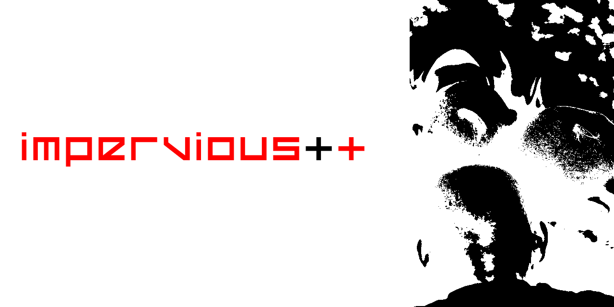

#  IMPERVIOUS

An ultra-performance, zero-dependency C++ native engine built from first principles for the ZMC–NUST Media Innovation Hackathon. IMPERVIOUS targets critical issues within Zimbabwe's media ecosystem: high data costs and vulnerable digital footprints.

## Key Subsystems
* **HTML Data-Stripping Core:** Linear string parsing algorithms that purge tracking scripts, stylesheets, and heavy DOM elements from web page dumps, compressing them into hyper-lightweight `.imp` text files.
* **Binary Metadata Tip-Line Sanitizer:** A byte-layer file utility that matches and destroys identifying segments (EXIF, device profiles, GPS coordinates) from anonymous media drops before disk write.

## Quick Start
```bash
# Compile the native engine
g++ -O3 -std=c++17 src/main.cpp -o impervious_engine

# Parse bloated media feeds into data-saving text
./impervious_engine input_feed.html output_report.imp
```
# IMPERVIOUS
